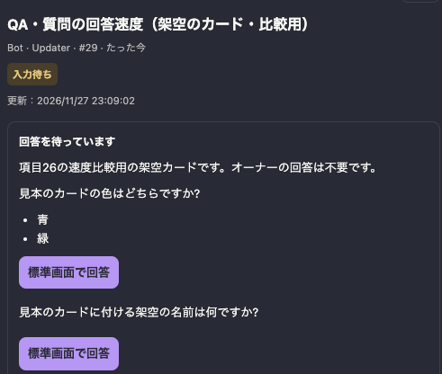

# 標準入力欄への返信速度

macOS 27.2.1（arm64、10コア）、Orca 1.4.279、日本語、可視ウィンドウ1つ。v0.2.13はCommunity導入版、v0.2.14は同じパネルと配布予定ワーカーを読み込んだ開発版。開発版だけ、比較中に両方のパネルを選べるようプラグインIDを分けた。既存のフォルダ版も同じ環境で稼働していた。

Updater #27 の通常返信はBotの予定グループを閉じた状態に戻し、SEO Botから一覧の「返信」を押した。Updater #29 の自由記述は、Botの標準Homeを一覧に戻してSEO Botに切り替えた後、Session Boardの詳細から2問目の「標準画面で回答」を押した。通常のポインター入力を再現するため、Orca Computer Useで取得したそのウィンドウの最新画像から対象ボタンを見つけ、背景座標クリックを使った。計時の起点はクリック指示直前。アクセシビリティで受付表示、対象Bot、標準項目、正しい編集欄へのフォーカスを順に観測した。表示の観測値にはComputer Useの応答と次の読み取りまでの時間が入る。

## 通常のパネル入口での計測

中央値と範囲は秒。フォーカスまでの時間は観測できた試行で集計し、下書きの列は架空の文字列が正しい欄に入ったことと消去の両方を確認できた件数。

| 操作・版 | 受付 | 対象Bot表示 | 標準項目表示 | フォーカス | 入力・消去 |
| --- | --- | --- | --- | --- | --- |
| #27 v0.2.13 | 0.553（0.550〜0.803） | 1.473（1.309〜1.871） | 2.262（2.082〜2.636） | 2.899（2.715〜3.121）、4/5 | 3/5 |
| #27 v0.2.14 候補 | 0.834（0.573〜1.409） | 1.642（1.216〜1.916） | 2.518（1.982〜3.092） | 3.255（2.486〜3.576）、3/5 | 3/5 |
| #29 v0.2.13 | 0.572（0.566〜1.513） | 1.580（1.347〜2.475） | 2.332（1.715〜3.091） | 3.199（2.230〜3.612）、5/5 | 4/5 |
| #29 v0.2.14 候補 | 0.589（0.581〜0.595） | 1.248（1.229〜1.335） | 1.620（1.609〜2.031） | 2.213（2.128〜3.032）、4/5 | 4/5 |

自由記述は、両版で入力・消去まで確認できた4組に絞ると、フォーカスの中央値が2.926秒から2.213秒へ約0.71秒短縮した。全観測値で見ると約0.99秒短縮した。候補の1試行はポインター配送前に `background_unavailable` で終了し、受付に到達しなかった。基準版では5回ともフォーカスに到達し、1回はその後の消去を自動確認できなかった。最後に該当の架空文字列を消去した。

通常返信は基準版のみの先行5回では5/5で入力・消去でき、フォーカスの中央値は2.695秒、範囲は2.567〜2.724秒だった。両版を交互に操作し、入力・消去まで確認できた3組のフォーカス時間は、3.044→2.486秒、3.121→3.255秒、2.715→3.576秒だった。バックグラウンドキー入力の拒否で検証文字列が残り、後続試行の空欄判定に影響した。検証文字列だけを消去して再計測すると、基準版は3/5で2.736秒（2.580〜2.749秒）、候補は4/5で3.043秒（2.489〜3.950秒）。この再計測の途中で、Updaterの標準チャットが基準版の照合に必要なプレースホルダーを表示しなくなった。基準版の後半2回は `bot-home-unavailable` で終了し、候補は同状態から標準欄への入力・消去まで到達した。通常返信の総時間は、今回の実機計測から短縮と判定できなかった。

## 呼び出し単位の計測

基準版の通常返信を別にプロファイルした1回では、対象の初回取得が182ms。その完了後に窓一覧と権限確認を並行に実行し、遅い方の完了まで131ms、続く初回AX読み取りに285msかかり、Bot遷移前で599msを使った。予定グループの展開と正しい項目を開くAX操作は360msと396ms。項目が開いた後のフォーカス操作は361ms、フォーカスを観測する次の読み取りは254msだった。

候補は対象取得・窓一覧・初回AX読み取りを並行に始める。アクセシビリティ権限は読み取り時にOrcaが検査する。一意な可視ウィンドウと最初のスナップショットのIDを照合し、判断が一致しない場合はそのウィンドウを指定して読み直す。操作前後の対象照合を残した。実機のワーカーログで、Bot遷移前の合計の中央値は #29 で713msから431ms、#27 の再計測で685msから450msだった。

実測したCLI遅延を同じ合成AX応答に与え、両版を各5回交互に実行した。通常返信のBot遷移前は602ms（599〜602ms）から309ms（308〜310ms）。自由記述は601ms（601〜602ms）から308ms（308〜309ms）。すべて正しい欄に到達した。この試験は、呼び出しの重なりによる差を切り分けるためのもので、画面の到達時間には含めない。

## 返信先と下書きの回帰確認

基準版は通常チャット欄のプレースホルダーが見つからないと、Botが画面に表示されていても遷移先を確定できなかった。候補は、編集欄と添付ボタンを含む同じコンテナのBot名付きコピー操作からBotを照合する。複数の候補があるときは停止する。実機の別のBot項目 #28 で、既存の標準チャット下書きを保持したまま、第2問の回答欄で架空の下書きの入力・消去に成功した。先行の1試行はBot切り替え後、項目が開く前に `item-unavailable` で止まった。各検証用項目の最終イベントIDは入力前後で一致した。

型検査、ビルド、Orcaの34テストは通過した。合成テストで複数の可視窓、別ウィンドウを返した初回AX読み取り、権限拒否、次回の再試行、連打、選択済み質問、既存の返信下書きを確認した。複数ウィンドウと別のMacは今回の実機試験の対象外。
